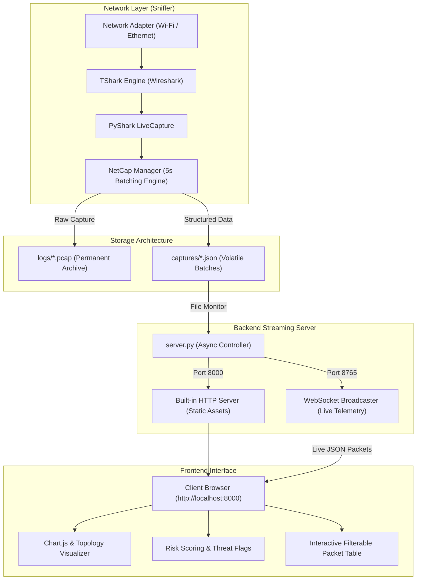

# NetVisor: Real-Time Passive Network Packet Capture & Security Analysis Platform

[](https://www.python.org/)
[](https://opensource.org/licenses/MIT)
[](https://www.wireshark.org/)
[](https://websockets.readthedocs.io/)
[]()
[]()

> **NetVisor** is a lightweight, cross-platform network packet capture engine and live security analysis dashboard. Built on top of PyShark (Wireshark/TShark) and Python asynchronous WebSockets, NetVisor captures live network traffic, groups it into 5-second batches, detects suspicious activities & threat vectors, and streams real-time telemetry to an enterprise-grade dark-themed web dashboard with zero Node/npm build dependencies.

---

## Table of Contents

- [Key Features](#-key-features)
- [System Architecture](#-system-architecture)
- [Project Structure](#-project-structure)
- [Prerequisites](#-prerequisites)
- [Installation](#-installation)
- [Quick Start](#-quick-start)
  - [1. One-Click Launcher](#1-one-click-launcher-recommended)
  - [2. Python CLI Launcher](#2-python-cli-launcher)
  - [3. Simulation / Demo Mode](#3-simulation--demo-mode-no-root-required)
  - [4. Manual Dual-Process Mode](#4-manual-dual-process-mode)
- [Command-Line Utilities](#-command-line-utilities)
- [Dashboard Capabilities](#-dashboard-capabilities)
- [Testing & Verification](#-testing--verification)
- [Troubleshooting](#-troubleshooting)
- [Ethical & Legal Notice](#-ethical--legal-notice)
- [License](#-license)

---

## ⚡ Key Features

- **Passive Network Sniffing**: Non-intrusive packet capture leveraging TShark and PyShark across Ethernet, Wi-Fi, and virtual adapters.
- **Enterprise Dark-Theme Dashboard**: Single-page web console featuring live packet throughput graphs, protocol breakdown donut charts, network topology mapping, and filterable packet inspection tables.
- **Zero-Dependency Web Stack**: Built with vanilla ES6+, CDN-delivered Tailwind CSS, Chart.js, D3, and Vis-network. No Node.js, npm, or frontend build toolchains required.
- **Asynchronous WebSocket Streaming**: High-throughput non-blocking dual HTTP (`:8000`) and WebSocket (`:8765`) server with connection backlog replay for newly joined clients.
- **Automated Dual-Tier Storage**:
  - `captures/`: Transient 5-second JSON batches consumed and rotated by the live frontend.
  - `logs/`: Long-term permanent PCAP captures and structured text/JSON audit logs.
- **Security & Risk Assessment Engine**: Heuristic scoring engine evaluating suspicious ports (e.g., Telnet 23, NetBIOS 135/139, SMB 445, RDP 3389, VNC 5900), abnormal MTU sizes, unencrypted protocols, and external IP endpoints.
- **Built-in Mock Traffic Simulator**: Test and demonstrate the full dashboard and analytics pipeline immediately without needing root/administrator network privileges.
- **Cross-Platform Compatibility**: Validated on Windows 10/11 and Linux (Ubuntu / Debian).

---

## 🏗️ System Architecture



---

## 📂 Project Structure

```
NetVisor/
├── captures/                    # Volatile 5-second JSON batches (.gitkeep)
├── docs/                        # Detailed architectural and academic documentation
│   ├── PROJECT_DOCUMENTATION.md # Comprehensive system technical specification
│   ├── BACKEND_CONNECTION_SUMMARY.md
│   ├── DASHBOARD_FEATURES.md
│   └── PRODUCTION_GUIDE.md
├── logs/                        # Permanent PCAP files and persistent audit logs (.gitkeep)
├── netcap_common/               # Core Python modular library
│   ├── __init__.py              # Library entry point & package exports
│   ├── active_scanner.py        # Active network discovery utilities
│   ├── base_interfaces.py       # Dataclasses & abstract base interfaces
│   ├── capture_manager.py       # PyShark capture & 5-second batch processor
│   ├── concurrent_filter_manager.py # Multi-threaded filtering engine
│   ├── file_manager.py          # Secure filename and directory management
│   ├── filter_handler.py        # BPF & protocol filter compilation
│   ├── folder_manager.py        # Dual-folder separation & automated cleanup
│   ├── interface_manager.py     # Cross-platform interface discovery & validation
│   ├── logging_manager.py       # Multi-format logging (JSON, UTC text)
│   ├── platform_manager.py      # OS detection, privilege checks & TShark verification
│   ├── shutdown_utils.py        # Graceful shutdown utilities
│   └── signal_handler.py        # POSIX/Windows signal management (SIGINT/SIGTERM)
├── tests/                       # Unit & integration test suite (16 tests)
│   ├── test_capture_config.py
│   ├── test_file_manager.py
│   ├── test_folder_manager.py
│   ├── test_interface_manager.py
│   ├── test_logging_manager.py
│   ├── test_platform_manager.py
│   └── test_server.py
├── web/                         # Web dashboard assets
│   ├── index.html               # Enterprise dark-themed dashboard
│   └── dashboard_v1.html        # Lightweight fallback monitor
├── .gitignore                   # Ignores .pcap, .log, temporary json, __pycache__
├── capture_all.py               # CLI wrapper for full packet capture
├── capture_ports.py             # CLI wrapper for port-specific capture
├── capture_protocols.py         # CLI wrapper for protocol-specific capture
├── index.html                   # Root index.html for direct zero-config web serving
├── LICENSE                      # MIT License
├── netcap_manager.py            # Primary CLI dispatcher & coordinator
├── pyproject.toml               # Python package configuration & pytest settings
├── requirements.txt             # Pinned Python package dependencies
├── server.py                    # Dual HTTP & WebSocket streaming server
├── Server1.py                   # Server alias for backwards compatibility
├── start_live_dashboard.bat     # Windows 1-click interactive launcher
├── start_live_dashboard.py      # Cross-platform launcher script
├── start_live_dashboard.sh      # Linux/macOS 1-click launcher
└── test_dashboard.py            # Mock traffic generator & simulation tool
```

---

## 🔧 Prerequisites

### 1. Wireshark / TShark
NetVisor relies on **TShark** (Wireshark's CLI) for packet extraction:
- **Windows**: Download and install [Wireshark](https://www.wireshark.org/). Ensure **"Install Npcap"** is selected. Verify that `C:\Program Files\Wireshark` is in your system `PATH`.
- **Linux (Debian/Ubuntu)**:
  ```bash
  sudo apt-get update
  sudo apt-get install -y tshark wireshark
  # Allow non-root users to capture packets (optional)
  sudo dpkg-reconfigure wireshark-common
  sudo usermod -aG wireshark $USER
  ```

### 2. Python 3.8+
Ensure Python 3.8 or higher is installed:
```bash
python --version
```

---

## 📦 Installation

1. **Clone the repository**:
   ```bash
   git clone https://github.com/<your-username>/NetVisor.git
   cd NetVisor
   ```

2. **Create and activate a virtual environment (recommended)**:
   ```bash
   # Windows
   python -m venv venv
   .\venv\Scripts\activate

   # Linux / macOS
   python3 -m venv venv
   source venv/bin/activate
   ```

3. **Install dependencies**:
   ```bash
   pip install -r requirements.txt
   ```

---

## 🚀 Quick Start

### 1. One-Click Launcher (Recommended)

#### On Windows:
Double-click `start_live_dashboard.bat` or run:
```cmd
start_live_dashboard.bat
```
*(The script displays available adapters, prompts for your interface—e.g. `Wi-Fi`—and starts both the server and capture engine).*

#### On Linux:
```bash
chmod +x start_live_dashboard.sh
sudo ./start_live_dashboard.sh
```

---

### 2. Python CLI Launcher

Start capturing directly on your active interface (e.g., `Wi-Fi` or `eth0`):
```bash
# Capture continuously
python start_live_dashboard.py --interface "Wi-Fi"

# Capture for 60 seconds
python start_live_dashboard.py --interface "Wi-Fi" --duration 60
```
Open **[http://localhost:8000](http://localhost:8000)** in any browser.

---

### 3. Simulation / Demo Mode (No Root Required)

To evaluate or demo the dashboard without capturing real network traffic:
```bash
python start_live_dashboard.py --demo
```
This launches the server and spawns an automated traffic generator producing synthetic TCP, UDP, HTTP, DNS, ICMP, and TLS packets.

---

### 4. Manual Dual-Process Mode

For advanced users or custom pipelines:
```bash
# Terminal 1: Start the streaming server
python server.py

# Terminal 2: List interfaces
python netcap_manager.py interfaces

# Terminal 2: Start packet capture
python netcap_manager.py capture --interface "Wi-Fi"
```

---

## 🖥️ Command-Line Utilities

NetVisor provides dedicated CLI tools for automated operations and scripting:

| Command | Description | Example |
|---|---|---|
| `python netcap_manager.py interfaces` | List all active and inactive network adapters | `python netcap_manager.py interfaces` |
| `python netcap_manager.py capture` | Run packet capture with folder management | `python netcap_manager.py capture --interface "Wi-Fi" --duration 30` |
| `python netcap_manager.py cleanup` | Clean up volatile JSON batches | `python netcap_manager.py cleanup --json` |
| `python capture_all.py` | Quick capture on an interface | `python capture_all.py -i eth0 -d 45` |
| `python capture_ports.py` | Capture with port filtering | `python capture_ports.py -i "Wi-Fi" -p "80,443,8080"` |
| `python capture_protocols.py` | Capture with protocol filtering | `python capture_protocols.py -i "Wi-Fi" -f "TCP,DNS"` |
| `python test_dashboard.py` | Generate test packet batches | `python test_dashboard.py --file-only` |

---

## 📊 Dashboard Capabilities

Access the web interface at `http://localhost:8000`:

1. **Live Network Telemetry**:
   - Total packets captured and packets/sec throughput.
   - Real-time protocol breakdown chart (HTTP, HTTPS, DNS, TCP, UDP, ICMP, TLS, QUIC).
   - Packet length distribution histogram.
2. **Security Risk Assessment**:
   - Automated anomaly detection for unencrypted transmission and high-risk ports.
   - Visual risk badges (`Critical`, `High`, `Medium`, `Low`).
3. **Interactive Packet Table**:
   - Sort and search by Source IP, Destination IP, Protocol, Port, or Info string.
   - Pause/Resume live streaming.
   - Clear view or export collected packets to JSON.
4. **Resilient Connectivity**:
   - Automatic WebSocket reconnection with status pill indicator (`Live`, `Connecting`, `Backend Offline`).
   - In-memory recent packet replay: never miss packets captured before opening the browser.
   - Automatic fallback to demo simulation if the backend is stopped.

---

## 🧪 Testing & Verification

The repository includes a comprehensive `pytest` test suite:

```bash
python -m pytest tests -v
```

**Test Coverage Highlights:**
- `test_platform_manager.py`: OS detection, Python version check, TShark discovery, privilege evaluation.
- `test_interface_manager.py`: Adapter listing, name sanitization, string similarity scoring.
- `test_folder_manager.py`: Directory creation, batch separation, JSON rotation.
- `test_file_manager.py`: Path traversal protection, safe filename timestamping.
- `test_logging_manager.py`: Multi-format text and JSON log formatter validation.
- `test_server.py`: Packet format transformation, port mapping, and client payload validation.

---

## ❓ Troubleshooting

| Issue | Cause | Solution |
|---|---|---|
| `tshark not found or not working` | Wireshark is not installed or not in system PATH | Install Wireshark and add its directory (`C:\Program Files\Wireshark`) to `PATH`. |
| `Permission denied` / `No packets captured` | Lack of administrative capture rights | On Windows: Run command prompt as Administrator. On Linux: Run with `sudo` or add user to `wireshark` group. |
| `UnicodeEncodeError` in Windows console | Windows console code page (cp1252) | NetVisor automatically reconfigures streams. You can also run `chcp 65001` before executing scripts. |
| Port `:8000` or `:8765` already in use | Another service is using the port | NetVisor enables `SO_REUSEADDR`. If a previous process is still bound, terminate it via Task Manager or `kill`. |

---

## ⚖️ Ethical & Legal Notice

NetVisor is designed exclusively for network diagnostics, educational exploration, authorized performance analysis, and security research.

> **Warning:** Capturing network traffic on systems or networks without explicit permission from the network owner may violate local, national, and international laws (such as the Computer Fraud and Abuse Act or the Computer Misuse Act). Always ensure you have authorization before monitoring network interfaces.

---

## 📄 License

This project is licensed under the MIT License - see the [LICENSE](LICENSE) file for details.
